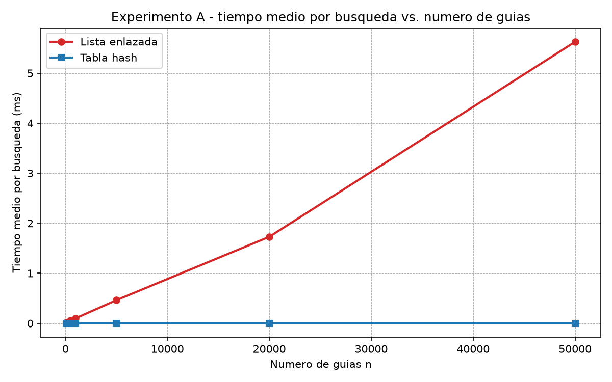
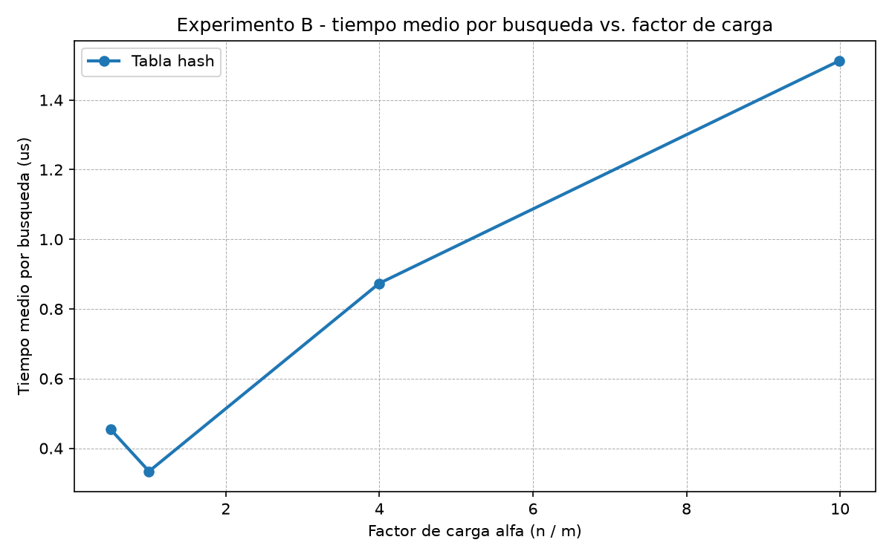

# Laboratorio 3 — Estructuras de datos: lista enlazada frente a tabla hash

> **Autor:** Juan David Machado Mosquera
>
> **Problema:** Rutas del Caribe mantiene unos 400.000 envíos activos. El call center consulta el estado de una guía y hoy la plataforma recorre una lista enlazada; además, un supervisor pide a diario "todas las guías entre X e Y". Se compara la lista enlazada con una tabla hash propia y se muestra en qué tarea cada estructura es (o no) adecuada.

---

## Cómo reproducir el experimento

1. Activar el entorno virtual de la raíz del repositorio:

    ```bash
    # Linux / macOS
    source venv/bin/activate
    # Windows (PowerShell)
    .\venv\Scripts\Activate.ps1
    ```

2. Instalar dependencias (matplotlib ya está en `requirements.txt`):

    ```bash
    pip install -r requirements.txt
    ```

3. Ejecutar las pruebas y la medición desde la raíz del repositorio:

    ```bash
    python laboratorios/lab3-estructuras-datos/pruebas.py
    python laboratorios/lab3-estructuras-datos/medicion.py
    ```

    El primer comando verifica las estructuras; el segundo regenera las dos imágenes dentro de `laboratorios/lab3-estructuras-datos/graficas/`.

---

## Parte 1 — Implementar y verificar las dos estructuras

Código: [`estructuras.py`](./estructuras.py) y [`pruebas.py`](./pruebas.py).

Implementé las clases `Nodo`, `ListaEnlazada` y `TablaHash`. La lista inserta al inicio en Θ(1) y busca con un ciclo `while` iterativo (sin recursión, para no tocar el límite de recursión). La tabla usa **encadenamiento** con `h(k) = k mod m`: cada casilla es una `ListaEnlazada`, `insertar` delega en la lista de su casilla y `buscar` recorre únicamente esa casilla. No uso `dict`, `set` ni la función `hash()` de Python.

Verifiqué con `pruebas.py`: búsqueda exitosa e infructuosa en ambas estructuras; la **colisión forzada** con `m = 7` (las guías `10`, `24` y `17` caen todas en la casilla 3, donde `10 % 7 = 24 % 7 = 17 % 7 = 3`) insertando y buscando las tres después, comprobando que la casilla 3 tiene longitud 3; que `factor_carga() == 3/7`; y **30 colecciones aleatorias** en las que lista y tabla devuelven el mismo estado tanto para guías existentes como para inexistentes.

---

## Parte 2 — Medir y graficar

Código: [`medicion.py`](./medicion.py).

Genero guías de diez dígitos con semilla fija 42 y, para las búsquedas infructuosas, uso la función `generar_guias_inexistentes` (semilla 7) que garantiza que ninguna guía está en la colección. Cronometro únicamente las búsquedas con `time.perf_counter()` (nunca la construcción ni la generación); mido el tiempo medio por búsqueda y repito cada medición **tres veces tomando la mediana**. Verifico con `assert` que lista y tabla devuelven el mismo estado para una muestra de guías existentes.

**Experimento A (lista frente a tabla).** Siete valores de `n`, con la tabla usando un `m` primo cercano a `n/2` para que `α ≈ 2`.



| n | m (primo) | α | Lista (ms) | Tabla (ms) |
|---:|---:|---:|---:|---:|
| 100 | 53 | 1.89 | 0.012 | 0.001 |
| 500 | 251 | 1.99 | 0.056 | 0.001 |
| 1000 | 503 | 1.99 | 0.100 | 0.001 |
| 5000 | 2503 | 2.00 | 0.461 | 0.001 |
| 20000 | 10007 | 2.00 | 1.729 | 0.001 |
| 50000 | 25013 | 2.00 | 5.626 | 0.001 |

**Experimento B (efecto del factor de carga).** Con `n = 20000` fijo, varié `m` para obtener `α` entre 0,5 y 10; aquí medí 2000 búsquedas por punto para estabilizar la medición en microsegundos.



| α | m | Tabla (μs) |
|---:|---:|---:|
| 0.50 | 40009 | 0.454 |
| 1.00 | 20011 | 0.334 |
| 4.00 | 5003 | 0.873 |
| 9.99 | 2003 | 1.512 |

---

## Parte 3 — Análisis

**1. Costo teórico.** Buscar una guía inexistente en la lista obliga a recorrer los `n` nodos desde la cabeza hasta el final, porque la guía no está en ningún nodo: cuesta Θ(n). En la tabla con encadenamiento, buscar calcula `h(k) = k mod m` (costo Θ(1)) y luego recorre la cadena de esa casilla. Bajo el **supuesto de hash uniforme simple** —cada clave cae con igual probabilidad en cualquiera de las `m` casillas, independientemente de las demás— la longitud esperada de cada cadena es `α = n/m`. Entonces el costo esperado es Θ(1 + α): el `1` por calcular el hash y el `α` por recorrer la cadena. Si todas las claves cayeran en la misma casilla, la tabla degeneraría en una lista enlazada y buscar volvería a costar Θ(n).

**2. Lo medido contra lo esperado.** En la primera gráfica, la curva roja (lista) crece de forma lineal: leyendo del gráfico, pasa de ~0.46 ms en `n = 5000` a ~5.63 ms en `n = 50000`; entre `n = 5000` y `n = 20000` (`n` ×4) el tiempo pasó de 0.461 a 1.729 ms (×3.75, cercano a 4), coherente con Θ(n). La tabla se mantiene plana en ~0.001 ms para todo `n`, coherente con Θ(1) cuando `α` es constante. En la segunda gráfica, cuando `α` crece de 1 a 4 el tiempo pasó de 0.334 a 0.873 μs (×2.6, la teoría predice (1+4)/(1+1) = 2.5), y de 1 a 10 pasó a 1.512 μs (×4.5 frente a (1+10)/(1+1) = 5.5); la tendencia creciente es coherente con Θ(1 + α), con el punto `α = 0.5` por debajo de `α = 1` dentro del ruido de microsegundos.

**3. Explique las colisiones.** Una colisión ocurre cuando dos claves distintas caen en la misma casilla. Ocurre aunque haya más casillas que guías porque el dominio de claves (10¹⁰ guías posibles) es mucho mayor que `m`; la función hash lo comprime a `m` valores, y nada impide que dos claves coincidan. El **encadenamiento** guarda en cada casilla una lista enlazada: insertar es Θ(1) (al inicio) y buscar recorre la cadena; su ventaja es que no impone límite de `α` y es simple, su costo es la memoria extra de punteros y cadenas largas. El **direccionamiento abierto** guarda todas las claves en la propia tabla y, ante una colisión, sondea la siguiente casilla libre; su ventaja es menos memoria y mejor localidad de caché, su costo es que exige `α < 1` y el borrado es complicado. Con `m = 7`, `10`, `24` y `17` colisionan en la casilla 3 (`10 % 7 = 24 % 7 = 17 % 7 = 3`): el encadenamiento los apila en la lista de esa casilla y las tres se insertan y buscan sin perderse.

**4. Tabla hash o árbol de búsqueda.** La tabla hash **no sirve** para el monitoreo por rango: reparte las claves en casillas sin conservar un orden entre ellas, de modo que "todas las guías entre X e Y" exigiría recorrer todas las casillas (o los 10¹⁰ valores posibles), no un rango contiguo. Un árbol binario de búsqueda conserva el orden, y su **recorrido en orden** visita las claves crecientes: para el rango `[X, Y]` se busca `X` y se sigue el recorrido en orden hasta `Y`, en Θ(h + k), con `h` la altura y `k` las guías del rango. Si las 400.000 guías llegaran ya ordenadas e insertadas una a una, el árbol degeneraría en una lista: altura `h = n = 400.000` y búsqueda con ~400.000 comparaciones. Un árbol equilibrado tiene altura `log₂(400.000)`, y como `2¹⁸ = 262.144` y `2¹⁹ = 524.288`, la altura es ~19 y una búsqueda cuesta ~19 comparaciones.

**5. Concepto para la jefa de operaciones.** Recomiendo **dos estructuras combinadas**: una **tabla hash** para la consulta puntual del call center y un **árbol binario de búsqueda equilibrado** (por ejemplo, rojo-negro o AVL) para el monitoreo por rango del supervisor. Estimando (no es una medición a esa escala): la lista crece linealmente según la gráfica, así que con 5.000.000 de guías una búsqueda inexistente tomaría del orden de **0,4 a 0,7 segundos** (escalando los 5,6 ms medidos en `n = 50000` por 100, no una regla de tres ciega sino la curva lineal que se observa). La tabla, en cambio, se mantiene plana en ~0,001 ms (0,5–2 μs) si se conserva `α ≈ 2` con `m ≈ n/2`, así que con 5.000.000 de guías seguiría en el orden del **microsegundo**.

---

## Estructura del entregable

```
laboratorios/lab3-estructuras-datos/
├── README.md
├── estructuras.py
├── pruebas.py
├── medicion.py
└── graficas/
    ├── lista_vs_tabla.png
    └── tiempo_vs_alfa.png
```